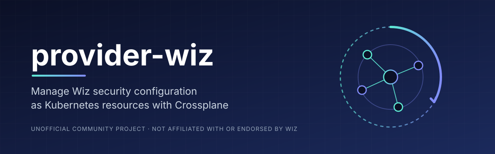

# provider-wiz



> [!IMPORTANT]
> **Unofficial provider.** This is a community project. It is not made, approved, endorsed or
> supported by Wiz, Inc. "Wiz" is a trademark of its owner and is used here only to describe what
> the provider manages. Use it at your own risk, and contact Wiz support only about Wiz itself,
> not about this provider.

`provider-wiz` is a [Crossplane](https://crossplane.io/) provider for [Wiz](https://www.wiz.io),
generated with [Upjet](https://github.com/crossplane/upjet) from the
[`jschoombee/wiz`](https://registry.terraform.io/providers/jschoombee/wiz/latest/docs) Terraform provider
([source](https://github.com/jschoombee/terraform-provider-wiz), currently pinned to `v0.0.7`).

The provider is moving, kind by kind, from Upjet to native controllers that call the Wiz GraphQL
API directly, so it is no longer limited to what the Terraform provider covers. Kinds marked
*native* below already use the Wiz API directly; see [docs/native-migration.md](docs/native-migration.md).
Every kind is served both cluster scoped (`*.wiz.polarpoint.io`) and namespaced for Crossplane v2
(`*.wiz.m.polarpoint.io`). All kinds are `v1alpha1` until they pass end-to-end tests against a
Wiz tenant.

| Group | Kinds |
| --- | --- |
| `project` | Project (*native*; cloud account links are part of its spec) |
| `iam` | ServiceAccount (*native*), User (*native*), SAMLIdP, SAMLGroupMapping |
| `connector` | AWS, GCP |
| `integration` | AWSSNS, Jira, ServiceNow |
| `automation` | RuleAWSSNS, RuleJiraAddComment, RuleJiraCreateTicket, RuleJiraTransitionTicket, RuleServiceNowCreateTicket, RuleServiceNowUpdateTicket |
| `policy` | CloudConfigRule, CloudConfigRuleAssociations, HostConfigRuleAssociations, Control, ControlAssociations, SecurityFramework, CICDScanPolicy |
| `report` | GraphQuery |

## Authentication

Create a Wiz service account, then store its credentials as JSON in a Secret. Keys match the
Terraform provider arguments. `wiz_url`, `wiz_auth_client_id` and `wiz_auth_client_secret` are
required; `wiz_auth_url`, `wiz_auth_grant_type`, `wiz_auth_audience`, `proxy`, `proxy_server`,
`ca_chain` and the `http_client_retry_*` settings are optional.

```yaml
apiVersion: v1
kind: Secret
metadata:
  name: wiz-creds
  namespace: crossplane-system
stringData:
  credentials: |
    {
      "wiz_url": "https://api.<region>.app.wiz.io/graphql",
      "wiz_auth_client_id": "<client id>",
      "wiz_auth_client_secret": "<client secret>"
    }
---
apiVersion: wiz.m.polarpoint.io/v1beta1
kind: ClusterProviderConfig
metadata:
  name: default
spec:
  credentials:
    source: Secret
    secretRef:
      name: wiz-creds
      namespace: crossplane-system
      key: credentials
```

A `ServiceAccount` managed resource writes `client_id` and `client_secret` to its connection
secret, so it can feed another ProviderConfig. Wiz returns the secret only when the service account
is created, so set `writeConnectionSecretToRef` before creating it.

## Developing

Run code generation:

```console
make submodules
make generate
```

`make generate` fetches the Terraform provider from the Terraform Registry to build
`config/schema.json`. Resource groups, kinds and references live in `config/resources.go`;
external names in `config/external_name.go`; credential handling in `internal/clients/wiz.go`.

Run against a Kubernetes cluster with Crossplane installed:

```console
make run
```

Build, push, and install:

```console
make all
```

Build the binary:

```console
make build
```

## Notes

- This provider runs the Terraform CLI (Upjet's CLI mode). Moving to Upjet's no-fork mode needs
  the Terraform provider to expose its `internal/provider` package publicly.
- `wiz_service_account` recreates the service account when its secret is rotated outside
  Crossplane if `recreateIfRotated` is set. Leave it unset if other tools rotate the secret.

## Report a Bug

Open an [issue](https://github.com/polarpoint-io/provider-wiz/issues).
